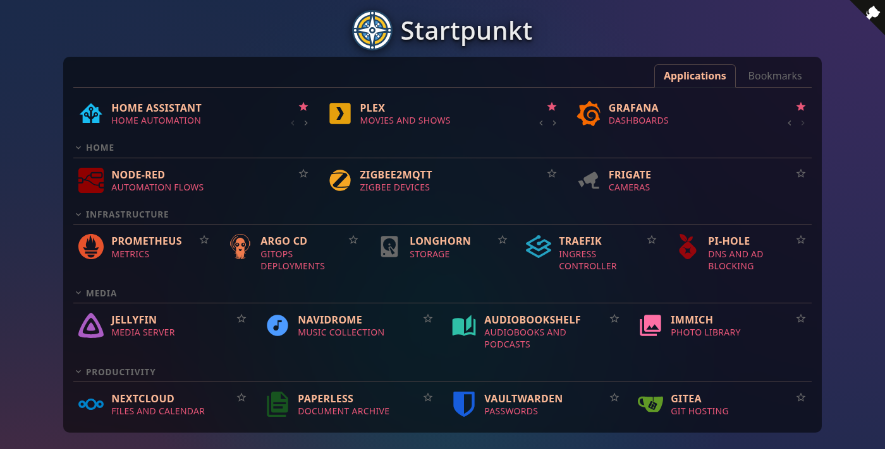
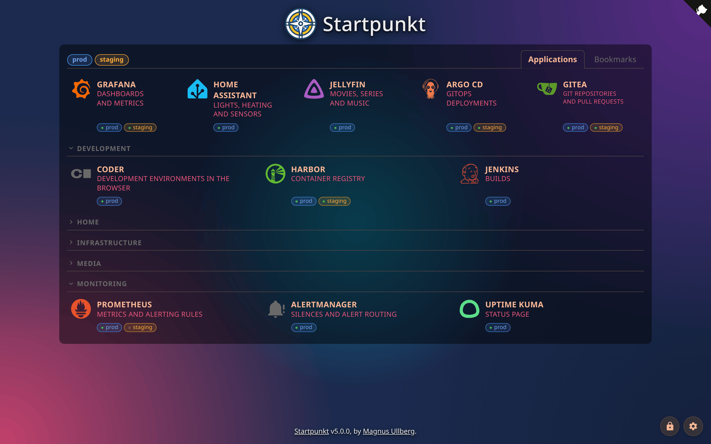
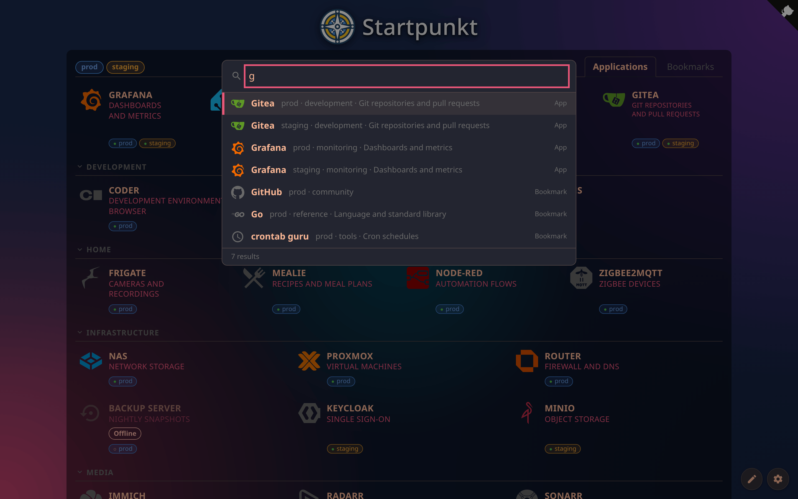

<h1 align="center">Startpunkt</h1>
<p align="center">
  <i>Startpunkt is a clean start page that shows links to the self-hosted services in your Kubernetes clusters.</i>
  <br/><br/>
  
  <br/><br/>
  <a target="_blank" href="https://github.com/ullbergm/startpunkt/releases"></a>
  <a target="_blank" href="https://github.com/ullbergm/startpunkt"></a>
  <a href="https://github.com/ullbergm/startpunkt/blob/main/LICENSE"></a>
  <br/>
  <a href="https://buymeacoffee.com/magnus.ullberg"></a>
  <a href="https://ullberg.us/cv.pdf"></a>
  <br/><br/>
  <a href="https://github.com/ullbergm/startpunkt/issues/new?assignees=&labels=bug&template=01_BUG_REPORT.md&title=bug%3A+">Report a Bug</a> ·
  <a href="https://github.com/ullbergm/startpunkt/issues/new?assignees=&labels=enhancement&template=02_FEATURE_REQUEST.md&title=feat%3A+">Request a Feature</a> ·
  <a href="https://github.com/ullbergm/startpunkt/discussions">Ask a Question</a>
  <br/><br/>
  
</p>

<details open="open">
<summary>Table of Contents</summary>

- [Features](#features)
- [Getting started](#getting-started)
- [Putting services on the page](#putting-services-on-the-page)
  - [Annotations](#annotations)
  - [Application resources](#application-resources)
  - [Bookmark resources](#bookmark-resources)
  - [Other resource types](#other-resource-types)
  - [Tags](#tags)
- [Editing from the page](#editing-from-the-page)
- [Configuration](#configuration)
- [Several clusters on one page](#several-clusters-on-one-page)
- [The page](#the-page)
- [Deployment modes](#deployment-modes)
- [API](#api)
- [Upgrading from 4.x](#upgrading-from-4x)
- [Development](#development)
  - [Built with](#built-with)
- [Support](#support)
- [Contributing](#contributing)
- [Security](#security)
- [License](#license)
- [Acknowledgements](#acknowledgements)

</details>

## Features

- **Automatic.** Services appear on the page when they are deployed to the cluster and disappear when they are removed. The page updates while it is open.
- **Reads what you already have.** Kubernetes Ingresses, OpenShift Routes, Gateway API HTTPRoutes and Istio VirtualServices, published with an annotation, and `Application` and `Bookmark` resources for everything else. Other resource types, such as a Traefik IngressRoute, can be added with one expression.
- **Availability.** Each application is probed from inside the cluster, and the page shows which ones do not answer.
- **Several clusters.** One instance can show the services of other instances next to its own, and combines a service that runs on several clusters into one card.
- **Search.** Start typing anywhere on the page to find a service, or search the web with a `?` in front.
- **Tags.** One instance serves several views: the path of the address chooses which tagged services are shown.
- **Yours to arrange.** Favorites, columns, backgrounds, themes and saved presets, per browser.
- **Editing, if you want it.** With an edit key configured, applications and bookmarks can be added, changed and deleted from the page.
- **GitOps ready.** Services, bookmarks and the settings of the instance are Kubernetes resources. A change to the settings is applied without a restart.
- **Small.** One static binary in a distroless image for amd64 and arm64. No database, and no third-party scripts on the page.
- **Private by default.** The page loads nothing from other hosts but pictures: icons are fetched and served by the instance, and the font is part of the page.
- **Accessible.** Semantic HTML, full keyboard navigation, visible focus, a high contrast mode, adjustable text size, and respect for reduced motion.
- **Internationalized.** English and Swedish are included.
- **Installable.** The page has a web app manifest, so a browser can add it to a home screen or open it in a window of its own.

There are pictures of most of this in the [gallery](docs/images/features/README.md).

## Getting started

Startpunkt is installed with its Helm chart:

```shell
helm install startpunkt oci://ghcr.io/ullbergm/charts/startpunkt \
  --namespace startpunkt --create-namespace
```

That gives you a running instance without a way in from outside the cluster. To have the chart create one, set an Ingress:

```shell
helm upgrade startpunkt oci://ghcr.io/ullbergm/charts/startpunkt --namespace startpunkt \
  --set ingress.enabled=true --set ingress.host=start.example.com
```

or, on OpenShift, a Route:

```shell
helm upgrade startpunkt oci://ghcr.io/ullbergm/charts/startpunkt --namespace startpunkt \
  --set route.enabled=true
```

Every setting of the chart is described in its [values.yaml](charts/startpunkt/values.yaml).

The chart installs four custom resource definitions. Helm keeps them in place when the release is uninstalled, because deleting a definition deletes every resource of its kind. Two of them, `Startpunkt` and `Remote`, are in the chart's `crds` directory, which Helm installs once and does not upgrade. After upgrading to a chart version that changes them, apply them yourself:

```shell
helm show crds oci://ghcr.io/ullbergm/charts/startpunkt | kubectl apply -f -
```

## Putting services on the page

### Annotations

An Ingress, Route, HTTPRoute or VirtualService is shown when it carries the annotation `startpunkt.ullberg.us/enable: "true"`. Its address comes from the object itself. Further annotations describe the tile:

| Annotation | Meaning |
| --- | --- |
| `startpunkt.ullberg.us/enable` | `"true"` to show the object, `"false"` to hide it |
| `startpunkt.ullberg.us/appName` | Name of the tile. Defaults to the object's name. |
| `startpunkt.ullberg.us/group` | Group the tile is listed under. Defaults to the namespace. Group names are shown in lower case, so `Media` and `media` are one group. |
| `startpunkt.ullberg.us/icon` | An [Iconify](https://icon-sets.iconify.design/) icon such as `mdi:home`, or the URL of a picture |
| `startpunkt.ullberg.us/iconColor` | Colour of the icon, for example `red` or `#e95678` |
| `startpunkt.ullberg.us/info` | Description shown under the name |
| `startpunkt.ullberg.us/location` | Sort position within the group. Lower comes first; the default is 1000. |
| `startpunkt.ullberg.us/url` | Use this address instead of the one the object describes |
| `startpunkt.ullberg.us/protocol` | `http` or `https`. Replaces what the object says about it. |
| `startpunkt.ullberg.us/port` | Port to add to the address |
| `startpunkt.ullberg.us/rootPath` | Path to add to the address |
| `startpunkt.ullberg.us/targetBlank` | `"true"` to open the link in a new tab |
| `startpunkt.ullberg.us/tags` | Comma-separated [tags](#tags) |

```yaml
apiVersion: networking.k8s.io/v1
kind: Ingress
metadata:
  name: grafana
  annotations:
    startpunkt.ullberg.us/enable: "true"
    startpunkt.ullberg.us/appName: Grafana
    startpunkt.ullberg.us/group: Monitoring
    startpunkt.ullberg.us/icon: simple-icons:grafana
    startpunkt.ullberg.us/rootPath: /dashboards
spec:
  rules:
    - host: grafana.example.com
      # ...
```

To show every object of a type without annotating each one, turn `onlyAnnotated` off for that source in the [settings](#configuration). An object is then hidden with `enable: "false"`.

### Application resources

An `Application` describes a tile by hand, for a service that none of the objects above describes:

```yaml
apiVersion: startpunkt.ullberg.us/v1
kind: Application
metadata:
  name: nas
  namespace: startpunkt
spec:
  name: NAS
  group: Infrastructure
  icon: mdi:nas
  url: https://nas.example.com
  info: Network storage
```

`spec` takes `name`, `group`, `icon`, `iconColor`, `url`, `info`, `targetBlank`, `location`, `rootPath` and `tags`, which mean what the annotations of the same name mean, and `enabled` to hide the tile without deleting the resource. There is no `port` or `protocol`: they are part of the `url`.

Instead of a fixed `url`, `urlFrom` reads the address from a field of another object, and follows it when that object changes:

```yaml
spec:
  name: Database console
  urlFrom:
    apiVersion: v1
    kind: Service
    name: console
    property: status.loadBalancer.ingress[0].ip
    urlTemplate: "https://{0}:8443/"
```

`apiGroup` names the API group of an object outside the core group, `namespace` defaults to the Application's own, and without `urlTemplate` the value is used as it is. `property` is a path of field names and list positions, such as `status.addresses[0].value`. When both `urlFrom` and `url` are set, `url` is used while the reference cannot be resolved. The controller needs to be allowed to read the referenced type; grant it with `rbac.extraRules` in the chart's values.

The controller writes what it found to the resource's status:

```console
$ kubectl get applications -A
NAMESPACE    NAME   TITLE   GROUP            URL                       AVAILABLE   AGE
startpunkt   nas    NAS     Infrastructure   https://nas.example.com   true        3d
```

On a cluster that also runs Argo CD, `applications` on its own means Argo CD's kind; write `applications.startpunkt.ullberg.us`.

A `Resolved` condition says why an Application has no tile, for example when its `urlFrom` points at something that does not exist.

### Bookmark resources

A `Bookmark` is a link to somewhere outside the cluster. Bookmarks are listed on a tab of their own.

```yaml
apiVersion: startpunkt.ullberg.us/v1
kind: Bookmark
metadata:
  name: kubernetes-docs
  namespace: startpunkt
spec:
  name: Kubernetes documentation
  group: Reference
  icon: mdi:kubernetes
  url: https://kubernetes.io/docs/
```

`name`, `group` and `url` are required; `icon`, `info`, `targetBlank` and `location` are optional. Bookmarks are not probed and have no tags.

### Other resource types

A resource type that Startpunkt has no source for can be added in the settings. An expression says where an object of that type is served, and the annotations above do the rest. This reads Traefik's IngressRoutes:

```yaml
sources:
  custom:
    - name: traefik
      apiGroup: traefik.io
      version: v1alpha1
      resource: ingressroutes
      defaultProtocol: https
      url: "object.spec.routes.map(r, hostFromRule(r.match))"
```

The expressions are [CEL](https://cel.dev), with the object as `object`. `url` gives a string or a list of strings, each an address with its scheme or a bare host name, and there is one tile for each. Only `http` and `https` addresses are accepted. `hostFromRule` and `hostsFromRule` take the host names out of a routing rule such as ``Host(`a.example.com`) && PathPrefix(`/x`)``.

As with the other sources, only annotated objects are shown unless `onlyAnnotated` is set to `false`. Optional expressions `tileName`, `tileGroup`, `icon` and `info` say what a tile shows when the object has no annotation for it. The chart gives the controller read access to each type that is listed. See [values.yaml](charts/startpunkt/values.yaml) for all of it.

A mapping that does not compile makes the settings invalid: none of the change is applied, the instance carries on with the last valid settings, and the status of the `Startpunkt` resource says what is wrong. One that fails on a particular object skips that object and says so in the controller's log.

### Tags

Tags choose what a visitor sees by the address they open. A tile without tags is always shown. A tile with tags is shown when one of its tags is in the path: `https://start.example.com/admin` shows the untagged tiles and those tagged `admin`, and `/admin,dev` those tagged with either.

Tags are a way to keep the page tidy, not access control: every visitor can open any path. See [object tag filtering](docs/object-tag-filtering.md).

## Editing from the page

By default the page only shows what is in the cluster. To let people add, change and delete `Application` and `Bookmark` resources from the page, give the instance an edit key:

```shell
kubectl -n startpunkt create secret generic startpunkt-edit-key --from-literal=key="$(openssl rand -base64 24)"
helm upgrade startpunkt oci://ghcr.io/ullbergm/charts/startpunkt --namespace startpunkt --reuse-values \
  --set editing.enabled=true --set editing.existingSecret=startpunkt-edit-key
```

While the page is being edited (the pencil in its corner), it then also has a lock and a button that adds a tile. Whoever enters the key gets an edit control on every tile that is an `Application` or a `Bookmark` of this cluster, and a form for adding new ones, which asks whether it is an application or a bookmark. New resources that are added on the page are created in the release's namespace, or the one set as `editing.namespace`. A change is a change to the resource, so it shows for everyone, and a resource that is also managed from Git will be changed back by whatever manages it. For that reason a resource that Argo CD or Helm deploys is read-only on the page: one that carries the annotation `argocd.argoproj.io/tracking-id` or `meta.helm.sh/release-name`, or the label `argocd.argoproj.io/instance`, `app.kubernetes.io/instance` or `app.kubernetes.io/managed-by`, has no edit control, and the API refuses to change or delete it.

Things to know before turning it on:

- The key is one shared secret, not a login. Everyone who has it can edit, and changes are not attributed to a person. It has to be at least 16 characters long.
- The browser keeps the key until the page is locked again.
- The instance is granted `create`, `update` and `delete` on the two resource types. Tiles that come from an Ingress, a Route or another cluster cannot be changed from the page.
- Only `http` and `https` addresses are accepted.
- The form checks what is typed and says what is wrong next to the field. It also asks the instance whether something answers at the address, and says so; an address that does not answer can be saved all the same. Whoever has the key can in this way learn whether an address answers from inside the cluster, which they could also learn by adding it as a tile.
- The group is picked from those in use or typed, tags are entered as pills, the icon is found by searching the icon sets, and its colour is picked from a palette, the browser's colour picker, or typed.
- Wrong keys are slowed down: after ten in a row, attempts are refused for a moment, for everyone, also with the right key.

## Configuration

The settings of an instance are a `Startpunkt` resource, which the chart creates from its values. The instance watches it and applies a change without a restart, and reports in the resource's status whether the settings are valid and in use:

```console
$ kubectl get startpunkts -n startpunkt
NAME         CONFIGURED   REASON   AGE
startpunkt   True         InUse    3d
```

Invalid settings are not applied. The instance keeps running with the last valid ones, and the status says what is wrong.

The sections of the settings, all of which are documented with their defaults in [values.yaml](charts/startpunkt/values.yaml):

| Section | What it controls |
| --- | --- |
| `cluster` | The name this instance gives its own cluster |
| `namespaceSelector` | Which namespaces are read: all of them, or a list |
| `sources` | Which resource types tiles are built from, and whether they must be annotated |
| `availability` | Probing of the services' addresses: interval, timeout, back-off |
| `status` | Whether the status of `Application` resources is written |
| `icons` | Where icons come from. The public Iconify API by default; point it at one you host to depend on nothing outside the cluster. |
| `web` | Title, default language, search engine, colours of the light and the dark theme, the update check, the link to GitHub, and the [default settings](#default-settings) of the page |

Every setting also has an environment variable, `STARTPUNKT_<SECTION>_<SETTING>`. With `customResources.enabled: false` the chart configures the pods through those instead of resources; a change then restarts the pods.

A change to how the cluster is read, which is the `cluster`, `namespaceSelector`, `sources`, `availability` and `status` sections, makes the instance read the cluster again. It reports itself as not ready for the moment that takes, and open pages are filled anew.

Startpunkt needs to read the resources it shows and nothing else. The chart creates a ClusterRole with `get`, `list` and `watch` on the enabled sources, and permission to write the status of its own resource types.

### Default settings

The settings of the page belong to each browser. What a browser starts from, before its visitor has changed anything, can be set for the instance, and "Reset to defaults" in the settings dialog goes back to the same. Give them under `config.web.defaultPreferences` in the chart's values (or as JSON in `STARTPUNKT_WEB_DEFAULTPREFERENCES`), in the form the page keeps them in:

```yaml
config:
  web:
    defaultPreferences:
      theme: dark                 # auto, light, dark
      colors: ocean               # default, ocean, forest, sunset, rose, slate, sand, lavender, mint, ember, mono
      handwrittenFont: false
      layout:
        columns: 4                # 0 for automatic, or 1 to 6
        showBoxes: true
        hoverEffect: true
        showDescription: true
        descriptionLines: 2       # 1 to 3, or 0 for no limit
        showTags: false
        showStatus: true
        hideUnreachable: false
        combine: true             # one card for a service on several clusters
        byCluster: false          # a section for each cluster
      background:
        type: gradient            # pictureOfDay, theme, solid, gradient, timeGradient, meshGradient, image, geopattern
        color: "#1b2a4e"
        color2: "#5b2a86"
        direction: to bottom right
        overlayOpacity: 0.7       # the panel behind the content: -1 solid white, 0 none, 1 solid black
        overlayBlur: 3
      accessibility:
        fontScale: 100            # 85, 100, 115, 130, 150
        highContrast: false
```

Leave out what should stay as the page has it. The page checks each value and uses its own default for one that does not fit. A browser that has not stored anything follows these settings, also when they change later; one whose visitor has changed a setting, marked a favorite or collapsed a group keeps what it has until it is reset. Favorites, collapsed groups and saved presets are kept by a reset.

## Several clusters on one page

An instance can show the tiles of other Startpunkt instances next to its own. Each of them is a `Remote` resource in the instance's namespace. The chart creates one for each entry under `federation.remotes` in its values, and you can add your own:

```yaml
apiVersion: startpunkt.ullberg.us/v1
kind: Remote
metadata:
  name: prod
  namespace: startpunkt
spec:
  url: https://start.prod.example.com
  # Optional: accept a certificate that cannot be verified, such as a
  # self-signed one.
  insecureSkipVerify: false
  # Optional: take only some of the remote's tiles.
  include:
    kinds: [application]
    groups: [media, "home*"]
  exclude:
    tags: [private]
```

The instance subscribes to the remote the way a browser does. The remote needs no configuration and does not know that it is being followed, so the instance has to be able to reach it. The resource's name is the cluster name its tiles are shown under.

```console
$ kubectl get remotes -n startpunkt
NAME   URL                              CONNECTED   TILES   AGE
prod   https://start.prod.example.com   True        42      3d
```

<p align="center"></p>

On the page, each cluster has a button above the tiles. A click shows that cluster alone and a second click shows all of them again; with Shift, Ctrl or Command held, a click adds or removes one cluster. The settings have a checkbox for each cluster as well. A new visitor sees the local cluster only, unless `web.showAllClusters` is set. A service that exists on several clusters is one card with a link per cluster; a preference lists each cluster in a section of its own instead. While a remote cannot be reached its last known tiles stay on the page, and the page says so.

Tiles are never passed on a second time: an instance takes from a remote only what that remote reads from its own cluster.

## The page

<p align="center"></p>

- **Search**: start typing, or press `/`, `Ctrl+K` or `Cmd+K`. A word finds the services whose name has a word that starts with it, accents aside, and a further word may name the cluster. `?` in front searches the web. A touch screen has a button for it.
- **Edit mode**: the pencil in the bottom right corner shows the controls of the tiles, and the check mark that replaces it, or Escape, hides them again.
- **Favorites**: in edit mode, the star on a tile puts it in a row at the top, which is reordered by dragging or with the buttons on each favorite.
- **Tabs and groups**: applications and bookmarks are on a tab each. A group is collapsed with its heading, and stays that way.
- **Settings**, bottom right, kept in the browser. What they start from can be set for the instance, see [Default settings](#default-settings):

  | Tab | What it holds |
  | --- | --- |
  | Appearance | Light, dark or automatic theme, the colours (the instance's own, or one of ten schemes that each have a light and a dark palette), language, a handwritten typeface |
  | Layout | Columns (automatic, or one to six), a box around each tile, a highlight under the pointer, whether descriptions, tags and status indicators show and how many lines a description may take, and hiding applications that do not answer |
  | Background | The Bing picture of the day, the theme's colour, a colour of your own, a gradient, a gradient that follows the time of day, a mesh gradient that can move, a picture by its address, or a generated pattern; with opacity, blur, and a panel behind the content that keeps text readable |
  | Presets | Named copies of the layout and the background, to save, apply and delete |
  | Clusters | Which clusters to show, whether a service on several clusters is one card, and a section for each cluster instead |
  | Accessibility | Text size from 85% to 150%, high contrast, and the list of keyboard shortcuts |

  Up to twenty presets can be saved.
- **Status**: the page says when it has lost its connection and is reconnecting, and when a cluster it shows cannot be reached. The footer names the running version. Unless the check is turned off, a golden ribbon across the top right corner names a newer release when one exists.
- **What's new**: the first visit after the instance was updated lists what changed since the version that browser last saw, taken from the project's changelog. The version in the footer opens the list again. That ribbon opens a list of what has changed since the running version, with a link to the release.

## Deployment modes

The chart's `mode` chooses between two ways of running the same image:

- `single`, the default: one Deployment watches the cluster and serves the page.
- `split`: three Deployments. `controller` watches the cluster and is the only one with Kubernetes credentials. `api` serves the tiles from the controller's state, and `web` serves the page. Only `api` and `web` are reachable from outside, and they scale without adding load on the Kubernetes API.

Every process is stateless, so more than one replica of each is safe. Each replica that watches the cluster probes the applications on its own, so replicas of `single`, or of `controller`, multiply the probes.

## API

The page uses a small HTTP API, and so can anything else:

| Endpoint | Purpose |
| --- | --- |
| `GET /api/v1/state` | Every tile, the clusters with their connection state, and the settings of the page. Answers with an `ETag`. |
| `GET /api/v1/events` | The same as a server-sent event stream: a snapshot, then every change as it happens |
| `GET /api/v1/version` | The running version, and a newer release when there is one |
| `GET /api/v1/changelog` | What changed in each release, newest first: the running version and those before it, and the newer ones when the update check has found one |
| `GET /api/v1/icons/{set}/{name}.svg` | An [Iconify](https://icon-sets.iconify.design/) icon, in the colour given as `?color=` |
| `GET /api/v1/icons?query=` | The names of the icons that match a word, for the icon picker of the editor |
| `GET /api/v1/background` | Address, title and copyright of the Bing picture of the day |
| `GET /healthz`, `GET /readyz` | Liveness and readiness. An instance is ready when it has read its cluster. |

```shell
curl -s https://start.example.com/api/v1/state | jq '.tiles[] | {name, url, available}'
```

With an edit key configured there are also `POST /api/v1/applications`, `GET`, `PUT` and `DELETE /api/v1/applications/{namespace}/{name}`, the same under `/api/v1/bookmarks`, and `GET /api/v1/unlock` to check a key and `POST /api/v1/check`, which says whether something answers at an address. They take the key as `Authorization: Bearer <key>` and a body of `{"spec": {...}}`. A `POST` may also give a `namespace`, which has to be one the instance reads, and a `name`; without them the resource goes to the editing namespace under a name made from its title.

The tile format is versioned, and other Startpunkt instances depend on it as much as the page does.

## Upgrading from 4.x

Startpunkt 5 is a rewrite. Annotated resources and existing `Application` and `Bookmark` resources work unchanged, and v5 can run next to a 4.x installation before you switch. Some things are different or gone, and the definitions of the custom resources need care when 4.x is removed. Read [Migrating from 4.x](docs/migrating-from-4.x.md) first.

## Development

The design and the reasons behind it are in [docs/v5-design.md](docs/v5-design.md).

```shell
make check          # Go and frontend tests, vet, type check, chart lint
make build          # frontend, then the binary with the frontend embedded, in bin/
make image          # container image
make crds           # regenerate the custom resource definitions after changing api/v1
make test-cutover   # the move from 4.x to v5 on a throwaway kind cluster
```

To work on the page, run the binary, which listens on port 8080, and start `npm run dev` in `web/`. The development server reloads on every change and passes `/api` on to the binary. To work on the page against an instance that is already running, in a cluster for example, name it in `STARTPUNKT_DEV_BACKEND`, in the environment or in `web/.env.local` (see `web/.env.example`), and no binary is needed.

The rules the code follows are in [AGENTS.md](AGENTS.md), with more for the page in [web/AGENTS.md](web/AGENTS.md) and for the chart in [charts/startpunkt/AGENTS.md](charts/startpunkt/AGENTS.md). What may come next is in the [roadmap](docs/roadmap.md).

### Built with

| Part | Technology |
| --- | --- |
| Server | [Go](https://go.dev), with the standard library's HTTP server and structured logging |
| Kubernetes | [client-go](https://github.com/kubernetes/client-go) dynamic informers and API discovery. Resource definitions are generated from Go types with [controller-gen](https://book.kubebuilder.io/reference/controller-gen). |
| Custom mappings | [CEL](https://cel.dev), with [cel-go](https://github.com/google/cel-go) |
| Live updates | Server-sent events, between the page and the server and between instances |
| Page | [Preact](https://preactjs.com) with [signals](https://preactjs.com/guide/v10/signals/) and [TypeScript](https://www.typescriptlang.org), built with [Vite](https://vite.dev) and embedded in the binary |
| Icons | [Iconify](https://iconify.design), fetched and cached by the server |
| Tests | Go's `testing` package with the client-go fake clients, [Vitest](https://vitest.dev) with [Testing Library](https://testing-library.com), and a [kind](https://kind.sigs.k8s.io) cluster for the move from 4.x |
| Packaging | A [distroless](https://github.com/GoogleContainerTools/distroless) image for amd64 and arm64, and a [Helm](https://helm.sh) chart published as an OCI artifact |
| Releases | GitHub Actions, [release-please](https://github.com/googleapis/release-please) and [Renovate](https://docs.renovatebot.com) |

## Support

Reach out to the maintainer at one of the following places:

- [GitHub Discussions](https://github.com/ullbergm/startpunkt/discussions)
- Contact options listed on [this GitHub profile](https://github.com/ullbergm)

If you want to say **thank you** or support active development of Startpunkt:

- Add a [GitHub Star](https://github.com/ullbergm/startpunkt) to the project.
- Buy me a [coffee](https://buymeacoffee.com/magnus.ullberg).

See the [open issues](https://github.com/ullbergm/startpunkt/issues) for proposed features and known issues.

## Contributing

First off, thanks for taking the time to contribute! Contributions are what make the open-source community such an amazing place to learn, inspire, and create. Any contributions you make will benefit everybody else and are **greatly appreciated**.

Please read [our contribution guidelines](docs/CONTRIBUTING.md), and thank you for being involved!

The original setup of this repository is by [Magnus Ullberg](https://github.com/ullbergm). For a full list of all authors and contributors, see [the contributors page](https://github.com/ullbergm/startpunkt/contributors).

## Security

Startpunkt follows good practices of security, but 100% security cannot be assured.
Startpunkt is provided **"as is"** without any **warranty**. Use at your own risk.

_For more information and to report security issues, please refer to our [security documentation](docs/SECURITY.md)._

## License

This project is licensed under the **MIT License**.

See [LICENSE](LICENSE) for more information.

## Acknowledgements

- [SUI](https://github.com/jeroenpardon/sui)
- [Hajimari](https://hajimari.io/)
- [Forecastle](https://github.com/stakater/Forecastle)
